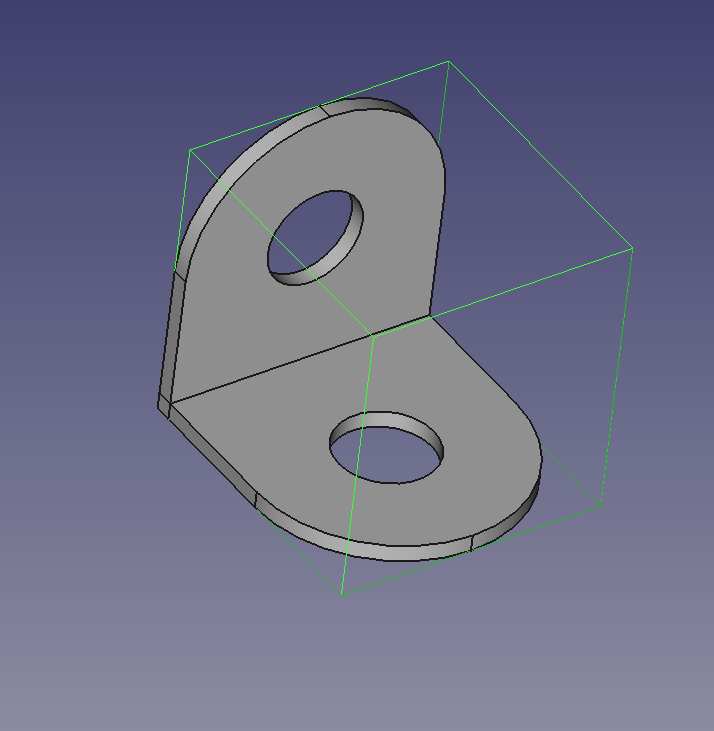
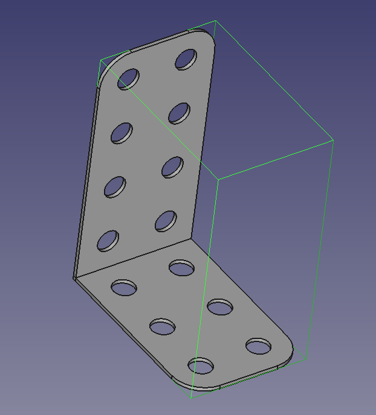
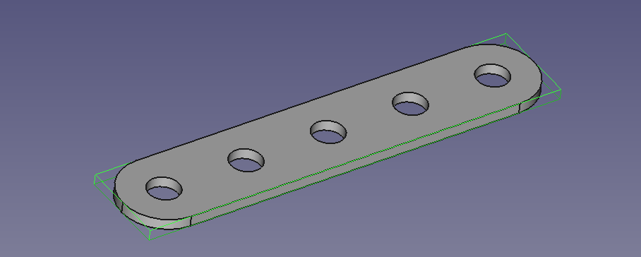
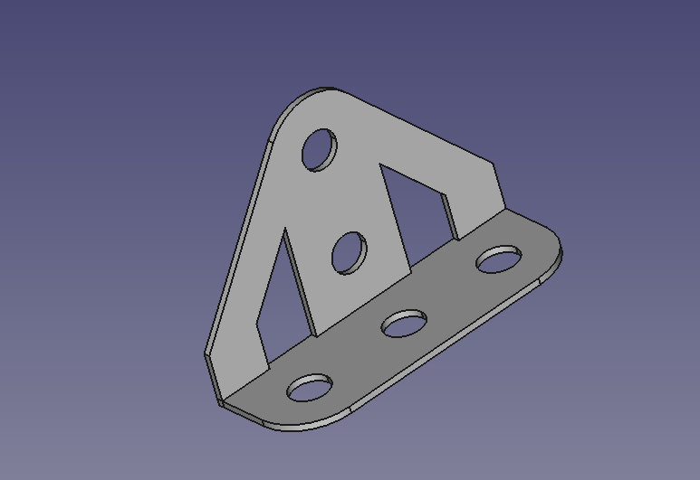
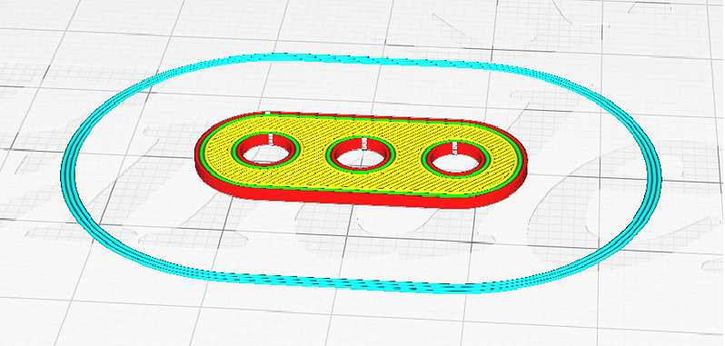

# Meccano

## FreeCAD Workbench

This project includes a FreeCAD Workbench and a python package, allowing you to use Meccano parts and tools directly within FreeCAD (or for producing FreeCAD documents) for advanced modeling and design workflows.

The workbench code is located in the `MeccanoWB/` directory. It provides custom tools, icons, and integration with FreeCAD's interface. The workbench is based on the meccano standalone package, see below.

**To use the workbench:**
- You can launch FreeCAD with the Meccano Workbench pre-installed using the provided Docker setup (see below).
- Or, copy the `MeccanoWB/` folder to your FreeCAD `Mod` directory.

## meccano package
The package allows to create individual pieces within FreeCAD without a GUI.

## Docker-based Development and Launch

This repository provides a Docker image and devcontainer configuration for both development and running the app with the FreeCAD workbench.

- **Development:**
  - Use [Dev Containers](https://containers.dev/) or VS Code's Remote - Containers extension to open the project in a fully configured development environment.
  - The Docker image includes all dependencies for Python development and FreeCAD scripting.

- **Launching the App with the Workbench:**
  - The Docker setup can also be used to launch FreeCAD with the Meccano Workbench enabled, making it easy to test and use the workbench without local installation hassles.
  - See the `docker-compose.yml` file for details.

---

Meccano is a Python library for modeling and programmatically generate mechanical pieces inspired by the Meccano system, such as strips, plates, hinges, and springs. The project provides classes and utilities to create, extrude, and manage geometric and mechanical components programmatically.

Pieces can be exported to STL format for 3D printing or further processing in CAD software. The library is designed to be used with FreeCAD, a powerful open-source parametric 3D CAD modeler.

## Features

- Compatible with FreeCAD 1.0.2
- Define and extrude custom mechanical pieces
- Manage geometries and constraints

## Supported Pieces






## Package Installation

1. Ensure you have Python 3.11+ installed.
2. FreeCAD must be installed and accessible in your Python environment
3. Insall the library using uv:

```bash
uv pip install .
```

## Usage

Import and use the library in your Python scripts:

```python
import FreeCAD as App

from meccano.pieces.l_shaped import Hinge

# create a new FreeCAD document
app = App.newDocument()

# Define a meccano part
hinge = Hinge(n_rows_x=2, n_columns=2, n_rows_z=2).build(app)

doc.saveAs('hinge')
```

## Preparing the part for 3d printing
Parts or assemblies can be exported from FreeCAD in STL format using the mesh workbench, and further processed for 3d-printing. Here you see a screenshot from the CURA software:


## Project Structure

- `meccano/`: Core library
  - `sketch_geometry.py`: Geometry and measurements utilities
  - `pieces/`: Mechanical piece classes (e.g., FlatStrip, Plate, Hinge, Spring)
- `test/`: Unit tests for the library
- `requirements.txt`: Python dependencies
- `pyproject.toml`: Project metadata

## Testing

Run tests using pytest:
```bash
pytest
```

## License
All code is licensed under the Apache License 2.0. See the LICENSE file for details.